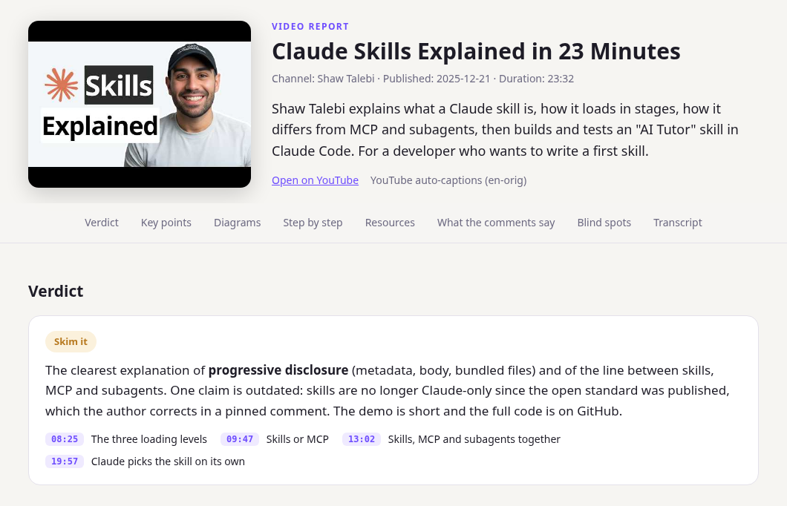
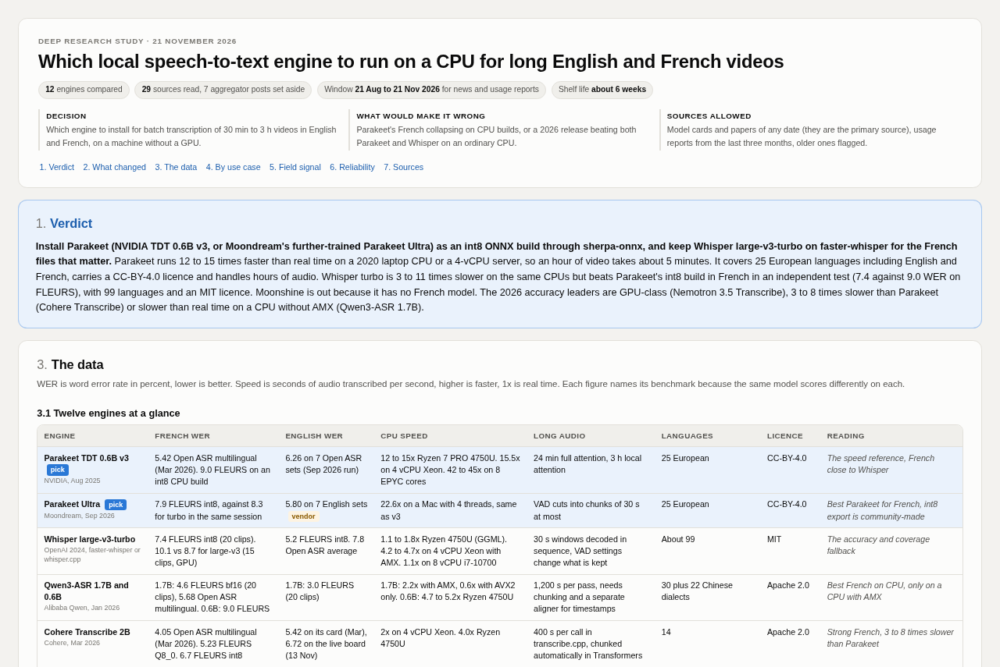
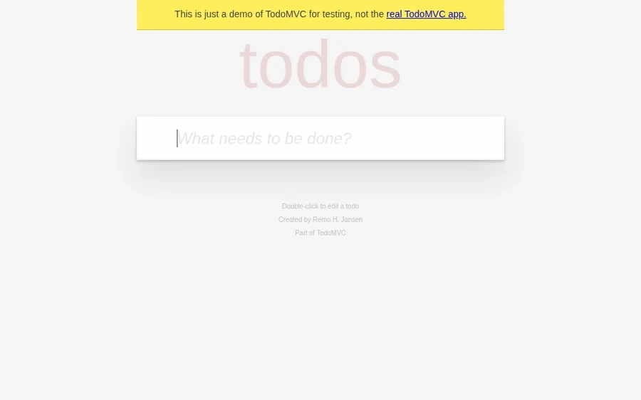
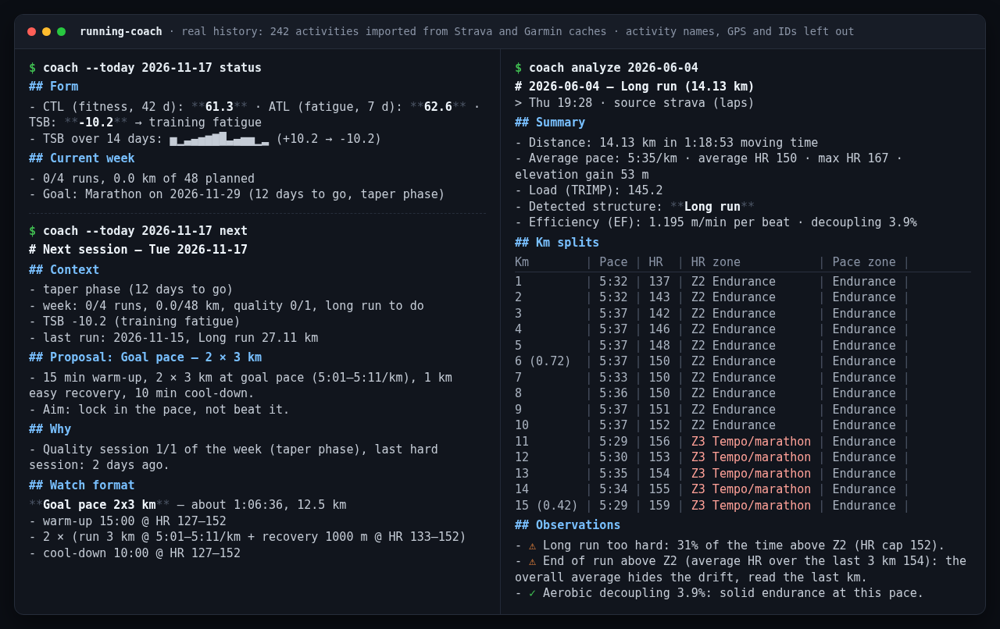
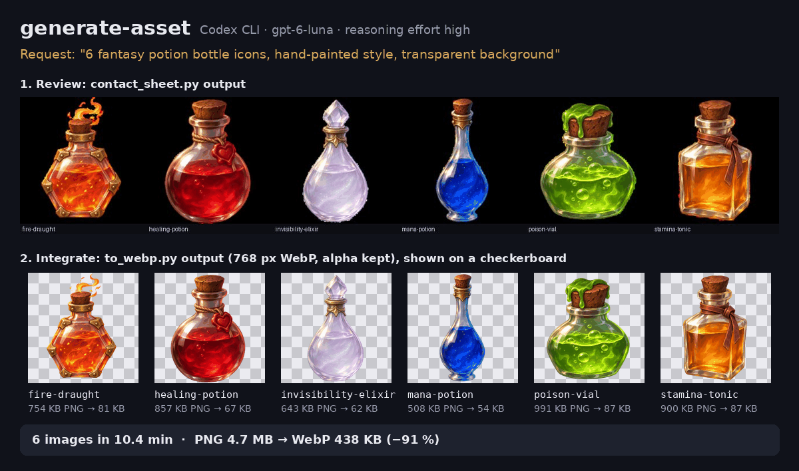
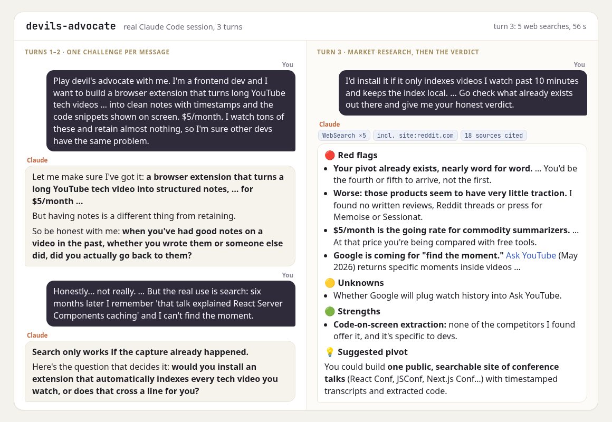
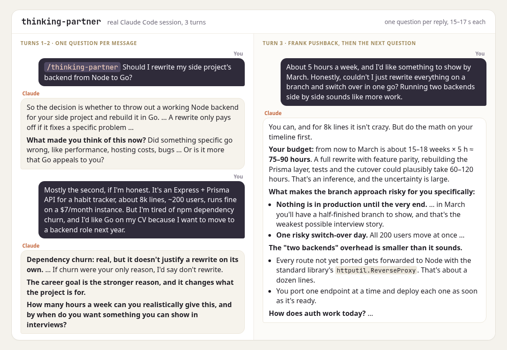

# Agent skills

[](https://github.com/monkeycs60/agent-skills/actions/workflows/check.yml) [](https://skills.sh/monkeycs60/agent-skills)

Skills for [Claude Code](https://code.claude.com) and Codex: folders of instructions and scripts that the agent loads when a request matches their description. Each one solves a real problem from my day-to-day work as a developer, ships tested scripts and documents its pitfalls.

```bash
npx skills add monkeycs60/agent-skills
```

| [`youtube-digest`](youtube-digest/): a 23-minute talk becomes a report with a verdict, 9 timestamped key points, 2 diagrams and 4 copyable steps, the full transcript alongside ([whole report](docs/youtube-digest-full.webp)) | [`explainer-video`](explainer-video/): the bundled example, a 37-second 1080p 60 fps film written in HTML, rendered and verified in under 2 minutes |
|---|---|
| <a href="docs/youtube-digest-full.webp"></a> |  |

| Skill | What it does | Requirements |
|---|---|---|
| [`youtube-digest`](youtube-digest/) | Turns a YouTube video or playlist into a structured HTML report: verdict, timestamped key points, diagrams, step-by-step with the code from linked articles, what commenters say. Always ships the full transcript, then answers questions about processed videos with sources. Uses YouTube captions, or local transcription (Parakeet) when there are none. | Python 3.10+. `install.sh` sets up yt-dlp and checks the rest: Chrome for diagrams, agent-browser and `gh` for linked pages, ffmpeg for videos without captions. Free. |
| [`deep-research`](deep-research/) | Multi-engine web research with dated sources checked against primary sources, delivered as a standalone HTML report. | API keys for Parallel, Exa, Tavily and Firecrawl (paid, about $0.10 per study) and their MCP servers. |
| [`explainer-video`](explainer-video/) | Builds a short motion-design explainer video in code (1080p, 60 fps MP4) for a feature or a doc, in the project's own visual identity, plus a YouTube kit (title, description, thumbnail). The bundled example renders in about 1.5 min. | Node 20+, Chrome or Chromium. ffmpeg recommended (three times smaller files). |
| [`chrome-pilot`](chrome-pilot/) | Browser automation on top of agent-browser: one pinned tab per agent conversation in your real Chrome (logins kept), or a sealed headless mode; proof videos, text snapshots before screenshots. | Chrome. `install.sh` installs agent-browser (0.42+, pinned 0.43). |
| [`running-coach`](running-coach/) | Running coach: syncs runs from Strava, falls back to Garmin Connect, or imports exported files (GPX, TCX, FIT, archives). Splits, session types, training load, weekly report, next workout, optional workout push to Garmin. | Python 3.10+. A Strava API app or a Garmin account, or just exported files. |
| [`generate-asset`](generate-asset/) | Generates a consistent batch of images (illustrations, icons, textures, logos) through Codex CLI, reviews them on a contact sheet and converts them to WebP. | Codex CLI signed in with a ChatGPT account. Pillow is installed on the fly by uv. |
| [`devils-advocate`](devils-advocate/) | Skeptical co-founder that challenges an idea before it gets built: one question at a time, market evidence from Reddit and the web, then an honest verdict. | None (the agent's web search; a Reddit MCP server is optional). |
| [`thinking-partner`](thinking-partner/) | Demanding Socratic partner to explore an idea and compare approaches before a decision. | None. |

Every skill is written in English and tells the agent to answer, and to write its reports, in the language of your request.

## Examples

Real runs on my computer, with my own data where a skill needs some.

| [`deep-research`](deep-research/): 12 local speech-to-text engines compared from 29 dated sources in 12 minutes, contradictions settled at the primary source ([whole report](docs/deep-research-full.webp)) | [`chrome-pilot`](chrome-pilot/): an agent adds, ticks and filters todos in an isolated headless Chrome, filmed with `ab record`, pointer and clicks drawn in |
|---|---|
| <a href="docs/deep-research-full.webp"></a> |  |

| [`running-coach`](running-coach/): real output on 2.5 years of Strava and Garmin runs: the next workout 12 days before a marathon, and a long run whose last 5 km drifted out of Z2 | [`generate-asset`](generate-asset/): six potion icons with real transparency from Codex CLI in 10 minutes, reviewed on a contact sheet, 4.7 MB of PNG down to 438 KB of WebP |
|---|---|
|  |  |

| [`devils-advocate`](devils-advocate/): a real Claude Code session: one challenge per message, then 5 web searches and a verdict with red flags, unknowns, strengths and a pivot | [`thinking-partner`](thinking-partner/): a real Claude Code session: one question per reply, then frank pushback on a big-bang rewrite with the time budget worked out |
|---|---|
|  |  |

## Install

With the [skills CLI](https://skills.sh) (Node 22+), for Claude Code, Codex and the other agents it supports:

```bash
npx skills add monkeycs60/agent-skills                              # choose skills and agents
npx skills add monkeycs60/agent-skills -g -y --skill youtube-digest  # one skill, for your user
```

Five skills ship an `install.sh` that checks or installs their dependencies (`youtube-digest`, `chrome-pilot`, `explainer-video`, `running-coach`, `generate-asset`). Their `SKILL.md` tells the agent what to do when a tool is missing; you can also run the installer yourself, for example `bash ~/.claude/skills/youtube-digest/install.sh`.

Or clone the repository, which also runs those installers:

```bash
git clone https://github.com/monkeycs60/agent-skills.git ~/agent-skills
cd ~/agent-skills
./install.sh                    # every skill
./install.sh youtube-digest     # or only some
```

`install.sh` links each skill into `~/.claude/skills` (and `~/.codex/skills` or `~/.agents/skills` when they exist) without overwriting an existing skill, then runs the skill's own installer if it has one. `git pull` keeps them up to date.

Linux and macOS. `youtube-digest` must run on a personal computer: YouTube blocks server IP addresses.

## Quality

- `python tests/check_skills.py` checks every skill on each push (GitHub Actions): frontmatter, English description under 300 characters, referenced files, `bash -n`, Python 3.10 syntax, `node --check`, executable bits.
- Each skill with scripts was installed and exercised from a clean clone in fresh Docker containers (Python 3.10, Node 20 and 22), with or without optional tools.
- No skill contains a key or personal data: secrets are read from the environment or from the user's config directory.

## Before you use them

A skill gives instructions to an agent that runs commands: read its `SKILL.md` first. HTML deliverables open in the browser, or render inline in [Pupitre](https://github.com/monkeycs60/pupitre) when the agent runs there.

## License

MIT
