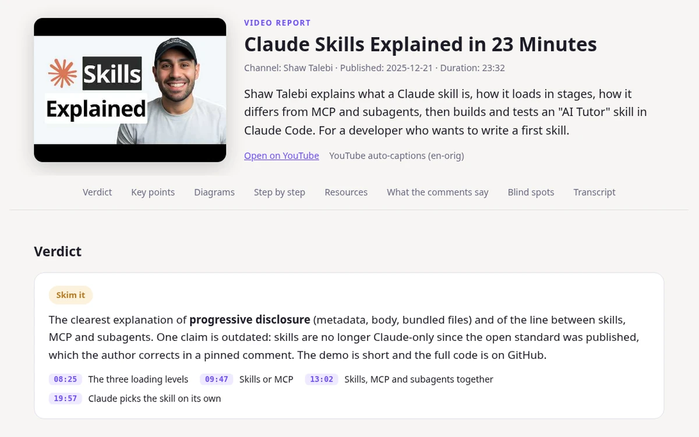
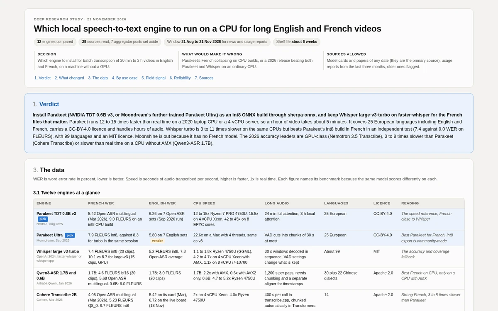
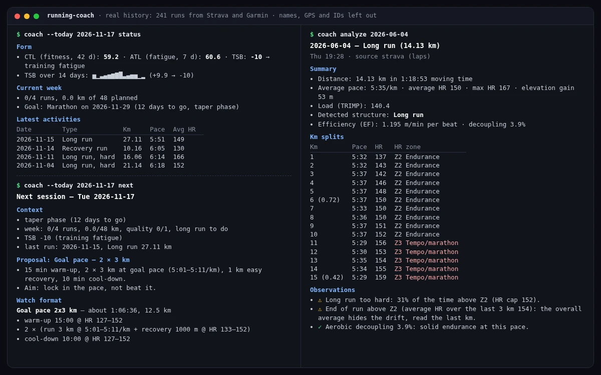
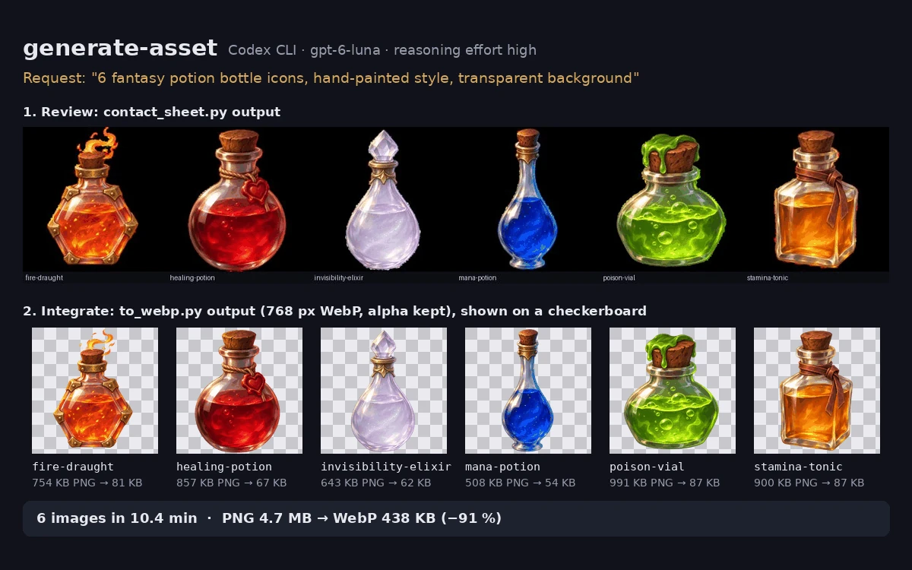
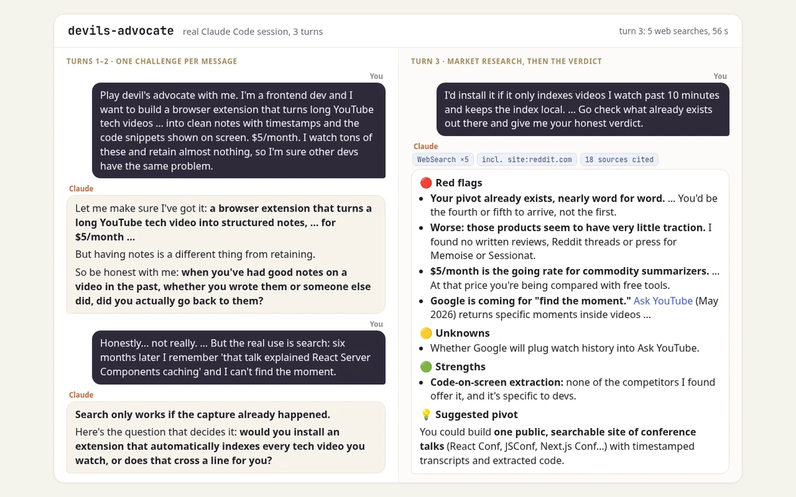
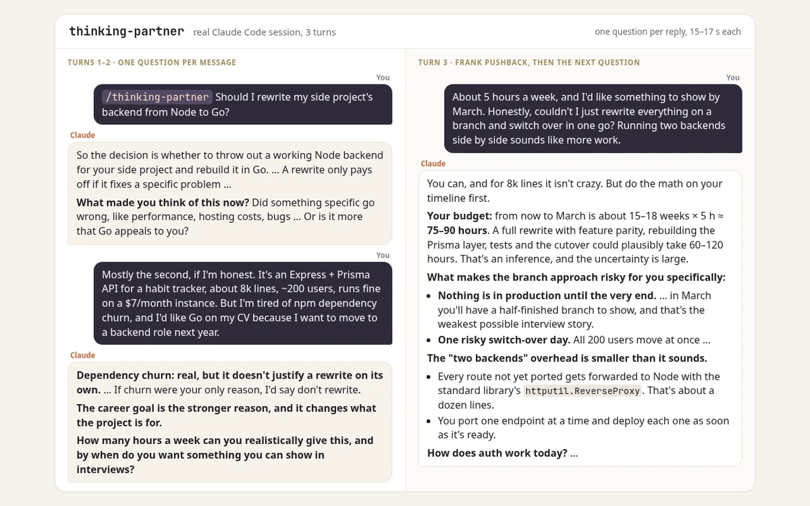
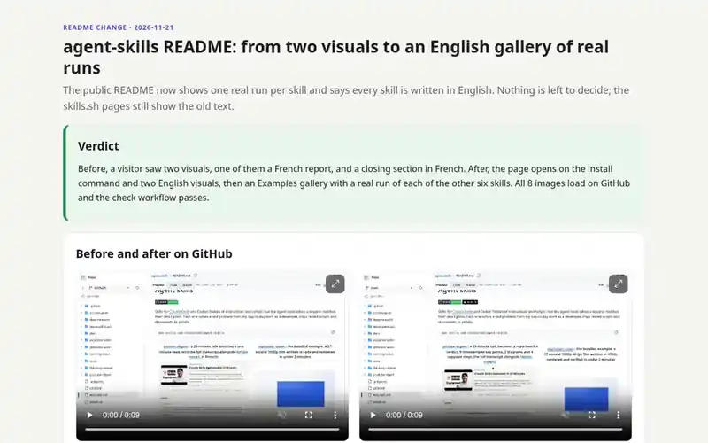

# Agent skills

[](https://github.com/monkeycs60/agent-skills/actions/workflows/check.yml) [](https://skills.sh/monkeycs60/agent-skills)

Skills for [Claude Code](https://code.claude.com) and Codex: folders of instructions and scripts that the agent loads when a request matches their description. Each one solves a real problem from my day-to-day work as a developer, ships tested scripts and documents its pitfalls.

```bash
npx skills add monkeycs60/agent-skills
```

## Examples

Real runs on my computer, with my own data where a skill needs some. Click an image to see it full size.

<table>
<tr>
<td width="33%" valign="top"><a href="docs/youtube-digest-full.webp"></a><br><b><a href="youtube-digest/"><code>youtube-digest</code></a></b><br><sub>A 23-minute talk becomes a report: verdict, 9 timestamped key points, 2 diagrams, the full transcript.</sub></td>
<td width="33%" valign="top"><a href="docs/deep-research-full.webp"></a><br><b><a href="deep-research/"><code>deep-research</code></a></b><br><sub>12 local speech-to-text engines compared from 29 dated sources in 12 minutes, settled at the source.</sub></td>
<td width="33%" valign="top"><a href="docs/explainer-video.webp"></a><br><b><a href="explainer-video/"><code>explainer-video</code></a></b><br><sub>The bundled example: a 37-second 1080p 60 fps film written in HTML, rendered in under 2 minutes.</sub></td>
</tr>
<tr>
<td width="33%" valign="top"><a href="docs/chrome-pilot.webp"></a><br><b><a href="chrome-pilot/"><code>chrome-pilot</code></a></b><br><sub>An agent adds, ticks and filters todos in an isolated headless Chrome, filmed with its pointer.</sub></td>
<td width="33%" valign="top"><a href="docs/running-coach.webp"></a><br><b><a href="running-coach/"><code>running-coach</code></a></b><br><sub>241 real runs: the next workout 12 days before a marathon, and a long run that drifted out of Z2.</sub></td>
<td width="33%" valign="top"><a href="docs/generate-asset.webp"></a><br><b><a href="generate-asset/"><code>generate-asset</code></a></b><br><sub>Six potion icons from Codex CLI in 10 minutes, checked on a contact sheet, 4.7 MB of PNG down to 438 KB.</sub></td>
</tr>
<tr>
<td width="33%" valign="top"><a href="docs/devils-advocate.webp"></a><br><b><a href="devils-advocate/"><code>devils-advocate</code></a></b><br><sub>A real session: one challenge per message, then 5 web searches and a verdict with red flags.</sub></td>
<td width="33%" valign="top"><a href="docs/thinking-partner.webp"></a><br><b><a href="thinking-partner/"><code>thinking-partner</code></a></b><br><sub>A real session: one question per reply, then frank pushback on a big-bang rewrite.</sub></td>
<td width="33%" valign="top"><a href="docs/visual-report.webp"></a><br><b><a href="visual-report/"><code>visual-report</code></a></b><br><sub>A before/after report of this README in one 1.7 MiB file; its viewer plays both videos side by side.</sub></td>
</tr>
</table>

## Skills

| Skill | What it does | Requirements |
|---|---|---|
| [`youtube-digest`](youtube-digest/) | Turns a YouTube video or playlist into a structured HTML report: verdict, timestamped key points, diagrams, step-by-step with the code from linked articles, what commenters say. Always ships the full transcript, then answers questions about processed videos with sources. Uses YouTube captions, or local transcription (Parakeet) when there are none. | Python 3.10+. `install.sh` sets up yt-dlp and checks the rest: Chrome for diagrams, agent-browser and `gh` for linked pages, ffmpeg for videos without captions. Free. |
| [`deep-research`](deep-research/) | Multi-engine web research with dated sources checked against primary sources, delivered as a standalone HTML report. | API keys for Parallel, Exa, Tavily and Firecrawl (paid, about $0.10 per study) and their MCP servers. |
| [`explainer-video`](explainer-video/) | Builds a short motion-design explainer video in code (1080p, 60 fps MP4) for a feature or a doc, in the project's own visual identity, plus a YouTube kit (title, description, thumbnail). The bundled example renders in about 1.5 min. | Node 20+, Chrome or Chromium. ffmpeg recommended (three times smaller files). |
| [`chrome-pilot`](chrome-pilot/) | Browser automation on top of agent-browser: one pinned tab per agent conversation in your real Chrome (logins kept), or a sealed headless mode; proof videos, text snapshots before screenshots. | Chrome. `install.sh` installs agent-browser (0.42+, pinned 0.43). |
| [`running-coach`](running-coach/) | Running coach: syncs runs from Strava, falls back to Garmin Connect, or imports exported files (GPX, TCX, FIT, archives). Splits, session types, training load, weekly report, next workout, optional workout push to Garmin. | Python 3.10+. A Strava API app or a Garmin account, or just exported files. |
| [`generate-asset`](generate-asset/) | Generates a consistent batch of images (illustrations, icons, textures, logos) through Codex CLI, reviews them on a contact sheet and converts them to WebP. | Codex CLI signed in with a ChatGPT account. Pillow is installed on the fly by uv. |
| [`devils-advocate`](devils-advocate/) | Skeptical co-founder that challenges an idea before it gets built: one question at a time, market evidence from Reddit and the web, then an honest verdict. | None (the agent's web search; a Reddit MCP server is optional). |
| [`thinking-partner`](thinking-partner/) | Demanding Socratic partner to explore an idea and compare approaches before a decision. | None. |
| [`visual-report`](visual-report/) | Builds a single-file HTML report (plan, audit, comparison, proof of a UI change) with embedded screenshots, before/after videos and its own click-to-zoom viewer that plays a before/after pair side by side; delivers it in Pupitre or the browser. | Python 3.10+. ffmpeg for videos; chrome-pilot or any browser tool for captures. |

Every skill is written in English and tells the agent to answer, and to write its reports, in the language of your request.

Every skill is written in English and tells the agent to answer, and to write its reports, in the language of your request.

## Install

With the [skills CLI](https://skills.sh) (Node 22+), for Claude Code, Codex and the other agents it supports:

```bash
npx skills add monkeycs60/agent-skills                              # choose skills and agents
npx skills add monkeycs60/agent-skills -g -y --skill youtube-digest  # one skill, for your user
```

Five skills ship an `install.sh` that checks or installs their dependencies (`youtube-digest`, `chrome-pilot`, `explainer-video`, `running-coach`, `generate-asset`). Their `SKILL.md` tells the agent what to do when a tool is missing; you can also run the installer yourself, for example `bash ~/.claude/skills/youtube-digest/install.sh`.

Or clone the repository, which also runs those installers:

```bash
git clone https://github.com/monkeycs60/agent-skills.git ~/agent-skills
cd ~/agent-skills
./install.sh                    # every skill
./install.sh youtube-digest     # or only some
```

`install.sh` links each skill into `~/.claude/skills` (and `~/.codex/skills` or `~/.agents/skills` when they exist) without overwriting an existing skill, then runs the skill's own installer if it has one. `git pull` keeps them up to date.

Linux and macOS. `youtube-digest` must run on a personal computer: YouTube blocks server IP addresses.

## Quality

Every push runs two checks on GitHub Actions, with Python 3.10:

- `tests/check_skills.py` checks the structure: every skill listed in `tests/skills.txt` is present and nothing else; frontmatter is strict YAML (no duplicate keys, name matching the folder, English description under 300 characters); every link and file path in a skill's documents exists inside the skill; no orphan document, stray file or broken symlink; `bash -n`, Python 3.10 syntax, `node --check`, and JSON and YAML parsing of every file.
- `tests/run_tests.py` checks the behaviour, offline and without any account or key: running-coach's own tests and a full offline run, a visual-report build of its starter report, youtube-digest's transcript-to-report round trip and search, generate-asset's WebP and contact-sheet conversion, `install.sh` in a throwaway home folder, and `npx skills add` of every skill, file by file.

To run them locally: `pip install -r tests/requirements.txt`, then `python tests/check_skills.py && python tests/run_tests.py`. Each skill with scripts was also installed and exercised from a clean clone in fresh Docker containers (Python 3.10, Node 20 and 22). No skill contains a key or personal data: secrets are read from the environment or from the user's config directory.

## Before you use them

A skill gives instructions to an agent that runs commands: read its `SKILL.md` first. HTML deliverables open in the browser, or render inline in [Pupitre](https://github.com/monkeycs60/pupitre) when the agent runs there.

## License

MIT
